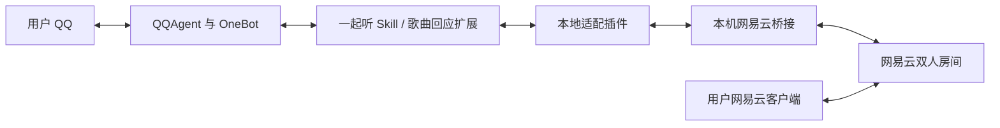

# QQAgent 网易云双人一起听

**让你的 QQA 在网易云中成为一起听的另一位成员，并在 QQ 聊天里参与选歌、歌曲讨论和日常音乐互动。**

本项目为 [QQAgent](https://github.com/K0nd1us/QQ-agent) 提供原生 Skill 与插件。你使用自己的网易云账号，QQA 使用独立的第二个网易云账号；双方加入同一个双人房间后，你可以在 QQ 中让它换歌、收藏、讨论当前歌词，也可以开启按人设决定的低频邀请、切歌回应和自主播放模式切换。

音乐由用户的网易云客户端播放，本项目负责房间交互、状态同步、歌曲资料和 QQ 对话。

## 适用对象

| 对象 | 可以用来做什么 |
| --- | --- |
| 已部署 QQAgent 的个人用户 | 在 QQ 私聊中控制一起听、选歌和查看房间状态 |
| 使用 AI 角色或陪伴型 QQA 的用户 | 让音乐互动沿用现有人设、称呼、口吻和音乐偏好 |
| 喜欢听歌、分享与讨论歌词的用户 | 与 QQA 共同选歌，聊正在播放歌曲的主题、意象和情绪 |
| QQAgent 扩展开发者、自部署用户 | 参考 Skill、确定性插件、本机桥接与独立后台调度的配合方式 |

使用者需要能够安装 QQAgent 扩展、准备两个网易云账号，并完成本机 Node.js、扫码登录与会话授权配置。

## 典型使用场景

| 场景 | 互动示例 | 实际行为 |
| --- | --- | --- |
| 日常一起听 | “创建一个一起听房间，先放一首轻松的歌。” | 搜索合适歌曲，由 QQA 专用账号创建双人房间，返回真实分享链接供你加入 |
| 学习、写作或休息时选歌 | “帮我挑一首安静一点的歌听。” | 在有效房间内根据讨论和偏好选歌，检查播放权限并核实结果 |
| 一起聊歌词 | “刚才这段歌词是什么意思？” | 获取当前歌曲及进度附近歌词，再结合上下文讨论 |
| 用户自己在网易云切歌 | 你在网易云客户端换了一首歌 | 开启歌曲回应扩展后，QQA 可按人设自然接话，也可以保持沉默 |
| 偶尔主动邀约 | 一段时间没有进行音乐互动 | 后台在满足条件时随机询问是否愿意一起听，收到明确同意后才开房 |
| 调整循环方式 | “这首单曲循环吧”“换成随机循环。” | 切换房间播放模式；明确的用户指令不占自主模式切换次数 |

以上示例均以相关模块已启用、QQ 会话已授权、账号在线且房间状态允许为前提。后台调度会在权限、忙碌、未读或房间条件不满足时跳过机会，不能保证每次到期都会发言。

## QQAgent 适配与运行方式

本仓库面向 QQAgent 的 **`skills/` 与 `plugins/` 原生扩展体系**：Skill 使用 `skill.json` 注册模型工具与提示规则，插件使用 `plugin.json` 提供受限本机能力，桥接服务负责网易云双人协议。

当前仓库整理与真实加载器验证所用宿主为 **QQAgent 0.4.8.5**。其他版本需具有兼容的扩展加载器、`api.capability`、技能状态查询、OneBot 上下文及控制台接口；尚未逐版验证兼容性。



QQA 的对话生成沿用宿主当前模型与人设配置；后台互动也会产生相应模型请求，实际费用遵循你已有模型服务的计费方式。安装本项目时无需额外在 Skill 源码中填写模型 API Key。

### 仓库组件

| 模块 | 版本 | 是否必需 | 作用 |
| --- | --- | --- | --- |
| `netease-listen-together` | 2.5.1 | 必需 | 双人房间、14 个音乐工具、随机邀请、自主播放模式 |
| `netease-song-review` | 1.4.2 | 可选 | 按人设回应切歌、歌曲点评、自主收藏及搜歌分享 |
| `netease-local-adapter` | 1.0.1 | 必需 | 受限本机通信、识别当前 QQA 实例、按需维护桥接进程 |
| `bridge` | 2.5.1 | 必需 | 网易云登录会话、双人协议、状态回读和操作限频 |

必需插件源码和独立说明见 [netease-local-adapter](plugins/netease-local-adapter/README.md)。安装版与仓库版的对应关系见 [插件来源与差异](plugins/netease-local-adapter/SOURCE.md)，首次上传及插件补充范围见 [push 说明](docs/PUSH_NOTES.md)。

## 具体功能

### 1. 双人房间与音乐控制

- **创建或加入房间**：用户明确要求后开房，或加入网易云官方双人邀请；支持官方完整分享链接与 `163cn.tv` 短链接。
- **选歌与共享歌单**：按歌名、歌手或歌曲 ID 搜索；选择并播放歌曲，或只追加到共享歌单而不切歌。
- **下一首与播放控制**：播放共享歌单下一首，按用户要求暂停或继续；这些操作可能影响房间双方。
- **房间状态查询**：读取成员、当前歌曲、进度及播放状态，服务端数据不完整时如实返回未知。
- **结束一起听**：用户明确要求后结束双方房间，需理解它会影响另一位成员。

选歌前检查机器人账号的完整播放权限，写操作后回读服务端确认。工具确认成功后，QQA 才应报告操作完成；结果未知时先查状态，避免连续重发。

### 2. 结合当前歌曲聊天

QQA 可以读取当前歌曲信息和进度附近的歌词，讨论主题、表达、意象和情绪。讨论前先获取真实资料，避免把邀请链接里最初的歌曲当作正在播放的歌曲。

它还可以读取 **QQA 专用网易云账号** 的“我喜欢的音乐”，把当前或指定歌曲收藏到该账号，并将真实收藏偏好与现有人设的音乐爱好结合，用于选歌和讨论。

本项目没有将音频交给模型听辨。基于歌名、元数据和歌词进行的讨论，不代表已经分析伴奏、唱法或音色。

### 3. 低频、随机的主动邀请

主动邀请由独立后台调度，不必等待用户先发一条 QQ 消息。它只向已授权私聊询问一起听的意愿，不会把邀请动作直接变成自动开房。

| 规则 | 默认行为 |
| --- | --- |
| 随机间隔 | 3～6 小时；首次启用也会先等待 |
| 邀请上限 | 同一机器人对所有收件人合计，滚动 24 小时最多 2 次 |
| 静默时间 | 北京时间 23:00～09:00 |
| 用户未回应 | 不追问、不催促 |
| 错过机会或条件不符 | 延后或重新安排，不补发积压邀请 |
| 发送结果未知 | 仍占用一次机会，不自动重发 |
| 开房条件 | 用户明确同意最近邀请，或直接主动要求开房 |

**用户主动命令 QQA 创建房间，不占用 QQA 的自主邀请次数。** 邀请计数用于限制后台主动打扰，不限制用户正常发起音乐互动。

### 4. 自主切换播放模式

支持 **单曲循环（`single`）、列表循环（`list`）、随机循环（`random`）**。开启音乐自主操作和自主模式切换后，后台会结合人设、最近聊天与当前房间判断是否有理由切换；也允许保持原模式。

- 两次自主切换至少间隔 **10 分钟**。
- 同一机器人跨会话、跨房间合计，滚动一小时最多 **3 次**。
- 用户明确指定模式不占自主次数，并进入 **一小时手动保护**。
- 计数和保护状态会持久化；重启不会自动清空限额，结果未知的尝试也计入次数。
- 模式切换只改变循环方式，不以此指令顺带切歌。

### 5. 可选的歌曲回应与自主发现

启用 `netease-song-review` 后，可使用以下能力：

| 能力 | 行为 |
| --- | --- |
| 回应歌曲变化 | 检测真实歌曲变化，等待稳定后，由当前人设决定是否回应；连续切歌会合并等待 |
| 歌曲点评 | 围绕当前歌和真实资料展开讨论，按需使用宿主允许的联网工具补充信息 |
| 喜欢的歌曲互动 | 根据专用账号的真实红心列表与现有人设，在合适时机聊歌 |
| 自主收藏 | 模型明确判断喜欢后，在权限和限额内收藏到 QQA 的网易云账号 |
| 自主搜歌分享 | 在有效、播放中的双人房间内寻找合适歌曲，分享真实网易云链接；不会因此直接切歌 |

各能力有独立开关与间隔设置。切歌回应默认等待歌曲稳定 10 秒，回应间隔至少 60 秒、每小时最多 6 次；模型可以选择不发言。完整配置字段见 [歌曲回应 Skill 清单](skills/netease-song-review/skill.json)。

### 主动操作与用户命令的区别

| 操作 | 触发方式 |
| --- | --- |
| 创建/加入/结束房间、只追加共享歌曲、暂停/继续 | 需要用户明确要求；用户明确同意最近一起听邀请也可进入开房流程 |
| 选歌、下一首、收藏 | 用户可直接要求；开启音乐自主操作后，也可在已授权的有效音乐会话中自主决定 |
| 发出一起听意愿邀请 | 后台随机机会、权限与频率检查通过后，再由模型判断是否发言 |
| 自主切换循环模式 | 后台检查开关、手动保护、当前会话与限额，再决定是否执行 |
| 切歌回应、点评、搜歌分享 | 需要安装并启用歌曲回应扩展及对应功能开关 |

本文以 **QQ 私聊** 为主要使用方式。主动邀请与切歌回应针对授权私聊；核心工具支持配置 `private:` / `group:` 会话，但群聊自主互动不在本项目已完整验证的场景范围内。

## 安装前准备

| 条件 | 要求 |
| --- | --- |
| QQAgent | 已部署并能正常聊天，支持上述原生扩展接口 |
| QQ 连接 | OneBot 已登录并连接到当前 QQA 实例 |
| 模型配置 | QQAgent 已有可用的模型与人设，能正常调用所需工具 |
| Node.js | 22 或更高版本；桌面版 QQA 需能找到 Node 可执行文件 |
| 网易云账号 | 两个不同账号：你的账号与 QQA 专用账号 |
| 播放权限 | QQA 专用账号对目标歌曲具备完整播放权限 |
| 授权 | QQA 全局会话名单、Skill 会话名单、所需工具与插件权限均已配置 |

同一个网易云账号同时登录两台设备，仍不构成两位双人房间成员。当前桥接维护一份房间绑定，不能把同一专用账号当成多个独立陪听成员使用。

## 安装与首次使用

### 第一步：下载并检查仓库

```powershell
git clone https://github.com/beibefrancisco665-dot/netease-listen-skill.git
cd netease-listen-skill
npm run setup
npm test
```

这里的 `setup` 为仓库副本安装桥接依赖，`test` 运行模拟测试。正式部署仍需完成下面的复制、登录和授权。

### 第二步：放入对应目录

关闭 QQA 并备份已有同名模块，按实际应用/数据目录复制：

| 仓库内容 | 正式位置 |
| --- | --- |
| `skills/netease-listen-together/` | `<QQAgent应用目录>/skills/netease-listen-together/` |
| `skills/netease-song-review/`（可选） | `<QQAgent应用目录>/skills/netease-song-review/` |
| `plugins/netease-local-adapter/` | `<QQAgent应用目录>/plugins/netease-local-adapter/` |
| `bridge/src/`、`bridge/scripts/`、`bridge/package.json`、`bridge/package-lock.json` | `<QQAgent数据目录>/netease-bridge/` 下保持相同层级 |

**一起听 Skill、本地适配插件、桥接服务需要一起部署。** 保留目录名和相对层级；升级代码时保留既有运行时会话与限频状态。完整路径确认和更新步骤见 [INSTALL.md](docs/INSTALL.md)。

### 第三步：安装正式桥接依赖并扫码

在正式桥接目录执行以下操作。请将路径占位符替换为当前实例的数据目录：

```powershell
cd '<QQAgent数据目录>/netease-bridge'
npm ci --ignore-scripts
npm run login
```

按终端显示的图片路径打开二维码，使用 **QQA 专用的第二个网易云账号** 扫码确认。会话与二维码在该桥接目录的 `runtime/` 保存；连接配置 `runtime/1014_连接配置_v1.json` 会自动生成。

### 第四步：在本机配置并启用

1. 将一起听、本地适配及所选歌曲回应模块 ID 追加到 QQA 的 `trustedPlugins`。
2. 一起听及歌曲回应扩展填写相同的本机 `bridgeUrl`、`bridgeToken` 和对应允许会话。
3. 私聊会话填写 `private:发起人的QQ号`，例如 `private:123456789`，不要填机器人自己的 QQ。
4. 确认全局会话权限及媒体/消息工具权限，然后启用本地适配和所需 Skill。
5. 按宿主提供的重载方式加载模块，或重启 QQA，查看“网易云本机通信”状态。

连接密钥只在本机查看并填写。可参考 [配置示例](config/qqa.example.json) 合并所需字段，保留原来的完整配置；示例中的密钥和 QQ 会话默认留空，模块默认不启用。

桌面版默认从 PATH 寻找 `node`。若启动失败，可在适配插件设置的 `nodeExecutable` 中填写完整 `node.exe` 路径，无需附加引号或参数。

### 第五步：在 QQ 中开始一起听

可按顺序尝试：

1. “搜索一下这位歌手的歌。”
2. “创建一起听房间，先放这首歌。”或“加入这个一起听邀请：……”
3. 你用自己的网易云账号加入同一房间，在客户端播放。
4. “下一首”“这首单曲循环”“聊聊现在这首歌的歌词”。

后台主动功能需等待各自的调度与条件判断；刚启用后没有立即邀请或发言，属于可能的正常情况。

## 开关与默认节奏

以下是主要开关；只有模块启用、配置有效且会话授权后，对应能力才可能运行。

| 设置 | 默认值 | 作用 |
| --- | --- | --- |
| `autonomousMusic` | `true` | 允许音乐会话中的自主选歌、切歌和收藏 |
| `proactiveInvitations` | `true` | 开启随机意愿邀请；3～6 小时、滚动 24 小时最多 2 次 |
| `autonomousPlayModes` | `true` | 开启自主模式切换；至少 10 分钟、滚动一小时最多 3 次 |
| `reactToSongChanges` | `true` | 歌曲回应扩展的切歌回应开关 |
| `autonomousDiscovery` | `true` | 歌曲回应扩展的自主搜歌分享；默认间隔 300 秒、每小时最多 6 次尝试 |
| `autoStartBridge` | `true` | 本地适配插件启用后按需维护桥接进程 |

不需要某类主动互动时，可关闭对应开关；清空并保存 Skill 的允许会话会撤销该会话授权。模式和邀请的频率限制有代码硬边界，不能仅靠填写更小间隔绕过。

## 核心工具一览

一起听 Skill 注册以下 **14 个工具**，由 QQAgent 根据自然语言需求调用：

| 工具 | 功能 |
| --- | --- |
| `search` | 搜索歌曲 |
| `join` | 加入官方双人邀请 |
| `create` | 创建双人房间并取得分享链接 |
| `push` | 只追加到共享歌单 |
| `choose` | 按歌曲 ID 或关键词选歌并播放 |
| `like` | 收藏当前或指定歌曲到 QQA 专用账号 |
| `favorites` | 读取 QQA 专用账号的红心列表 |
| `next` | 播放共享歌单下一首 |
| `play_mode` | 切换单曲、列表或随机循环 |
| `play_mode_state` | 查询模式、手动保护和自主限额 |
| `control` | 暂停或继续 |
| `state` | 读取当前房间状态 |
| `context` | 获取当前歌曲与讨论资料 |
| `leave` | 结束双方房间 |

## 使用范围与常见问题

**支持多人房间吗？** 当前实现针对双人一起听。QQA 专用账号作为另一位成员加入，不能替代多个成员。

**QQA 会自己开房或结束房间吗？** 主动邀请只问意愿。创建、加入、结束以及暂停/继续等动作仍需用户明确要求；用户明确同意最近邀请后可开房。

**收藏会改动谁的账号？** 写入桥接登录的 QQA 专用网易云账号。它不会把用户提供的任意 UID 当成收藏目标。

**部署后电脑或手机会自动出声吗？** 本机桥接不播放声音。你仍在网易云客户端中收听，QQA 参与房间交互并在 QQ 中聊天。

**为什么会跳过推荐、邀请或模式切换？** 可能未到随机时间或冷却、已达限额、处于静默/手动保护时段，或当前无有效房间、会话忙碌、有未读、账号离线、权限撤销、模型决定保持沉默。到期检查不等于必定执行。

**可以只复制一个 Skill 文件夹吗？** 完整接入需要核心 Skill、适配插件和桥接。Skill 通过 `netease.local.fetch` 访问本机服务，相关组件缺失时应先补齐安装与配置。

外部网易云接口和账号播放权限会影响实际可用性。请以当前服务端回读与真实账号验证为准；本仓库不提供独立音乐客户端或歌曲文件下载。

## 数据与安全

- 网易云 Cookie、连接密钥、房间绑定、限频状态和二维码在本机生成；仓库不提供登录会话。
- 桥接仅监听 `127.0.0.1`，通过随机 Bearer 密钥、当前 QQA 实例、OneBot 身份和允许会话共同约束访问。
- 本地适配插件只开放音乐所需的接口白名单，不需要放开 QQA 全局内网访问权限。
- `.gitignore` 排除 `runtime/`、`data/`、`.env`、日志和依赖目录；提交前仍需检查实际暂存内容。
- 模型 API Key、连接密钥、Cookie、OneBot 凭据和完整日志均不应出现在公开 Issue、截图或提交中。
- 固定 SDK 的现有依赖告警和报告方式见 [SECURITY.md](SECURITY.md)；自动化测试通过不代表这些告警已经修复。

## 测试与验证范围

`npm test` 运行 **87 项自动化测试**，使用模拟网易云响应与临时本机 HTTP 服务检查房间协议、权限、随机邀请、模式限频、适配层及工具调用，不创建真实房间或向 QQ 发送消息。

如需使用你本机的真实 QQAgent 加载器进行隔离验证，设置 `QQA_SOURCE` 为带 `src/` 和已安装依赖的宿主应用目录，再执行：

```powershell
$env:QQA_SOURCE = '<QQAgent应用目录>'
npm run test:qqa
```

它会复制宿主源文件到仓库隔离目录，不读取正式账号配置，也不启动正式音乐桥接。云端使用 **Windows/Linux × Node 22/24** 四组 CI 验证，当前结果可在 [GitHub Actions](https://github.com/beibefrancisco665-dot/netease-listen-skill/actions) 查看。

这些检查覆盖代码与加载流程。真实账号登录、当前网易云接口、实际播放效果和长期后台运行仍需在自己的环境验收。

## 目录与更多文档

```text
skills/
  netease-listen-together/   双人一起听核心 Skill
  netease-song-review/       可选歌曲回应与发现扩展
plugins/
  netease-local-adapter/     必需的受限本机通信插件
bridge/                     网易云桥接、登录脚本与协议测试
config/qqa.example.json     留空凭据的配置示例
docs/                       安装与 push 说明
test/                       邀请、适配与启动测试
scripts/test-host.mjs       隔离宿主加载验证
```

| 文档 | 内容 |
| --- | --- |
| [安装与配置](docs/INSTALL.md) | 目录确认、复制文件、扫码登录、授权及启用 |
| [插件说明](plugins/netease-local-adapter/README.md) | 必需插件的文件、设置和能力范围 |
| [插件来源与差异](plugins/netease-local-adapter/SOURCE.md) | 安装版 1.0.0 与仓库版 1.0.1 的对应关系 |
| [push 补充说明](docs/PUSH_NOTES.md) | 初次上传的组件范围与插件文档补充 |
| [版本记录](CHANGELOG.md) | 当前发布与整理变化 |
| [安全说明](SECURITY.md) | 凭据处理及已知依赖问题 |

## 来源与许可

本仓库代码采用 [MIT](LICENSE) 许可。QQAgent、网易云兼容 SDK 等来源与第三方许可见 [THIRD_PARTY_NOTICES.md](THIRD_PARTY_NOTICES.md)。桥接固定依赖 `@neteasecloudmusicapienhanced/api@4.40.1`，通过 npm 安装；网易云相关名称与服务归各自权利人所有。
